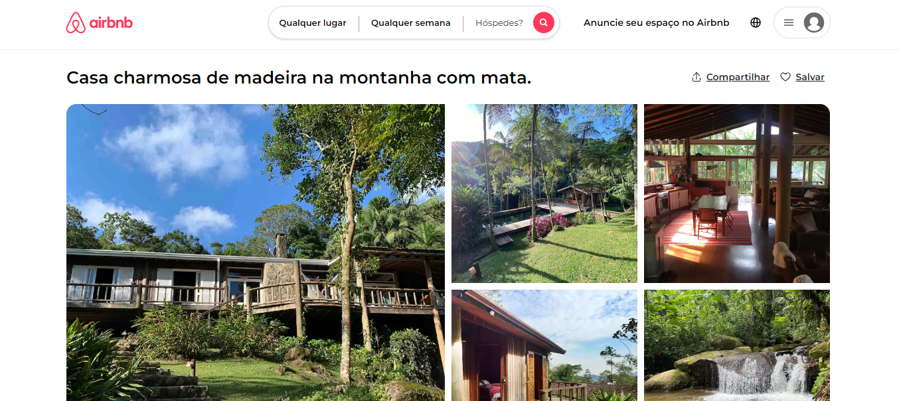

# Anúncio do Airbnb · Front-End Design

| Integrante | RM |
|---|---|
| [Guilherme Santos Nunes](https://github.com/sannunez) | RM558989 |
| [Kaique Zaffarani](https://github.com/Z4ffarani) | RM556677 |
| [Kairo da Silva Silvestre de Carvalho](https://github.com/KairoSilvestre) | RM558288 |
| [Rafael Menezes Viana](https://github.com/vianafs) | — |

Checkpoint 2 · 2024.2 · Engenharia de Software · FIAP

---

## Esta entrega: Front-End Design

Criação de um site que replica uma página de anúncio do **[Airbnb](https://www.airbnb.com.br)** utilizando tecnologias de front-end. O site é totalmente responsivo, com uma experiência otimizada para variados dispositivos. A troca entre as versões é feita dinamicamente com JavaScript, proporcionando uma transição suave e intuitiva.

Foram criados dois arquivos para o site:
- `index.html` | Arquivo principal para a versão de computador (desktop). Contém a estrutura de layout e elementos voltados para telas maiores, como de tablets e notebooks.
- `mobile.html` | Arquivo dedicado à versão de celular (mobile). Possui uma estrutura simplificada e adaptada para telas menores, garantindo dinamismo, usabilidade e performance.

| Link | Onde |
|---|---|
| Site publicado | [z4ffarani-educational.github.io/2024-SEM2-CP2-FRONT-END-DESIGN](https://z4ffarani-educational.github.io/2024-SEM2-CP2-FRONT-END-DESIGN/) |
| Anúncio original | [airbnb.com.br/rooms/43811303](https://www.airbnb.com.br/rooms/43811303) |

## Prévia



## Como executar

```bash
git clone https://github.com/Z4FFARANI-EDUCATIONAL/2024-SEM2-CP2-FRONT-END-DESIGN.git
cd 2024-SEM2-CP2-FRONT-END-DESIGN/docs
```

Depois, abra o arquivo `index.html` ou `mobile.html` no navegador.

## Funções

`index.html` e `mobile.html`:
- **Escutador de evento** | Detecta a proporção da tela e alterna entre os arquivos HTML de acordo com o tamanho da janela do navegador. A função `addEventListener` monitora o evento de redimensionamento (`resize`) e, ao identificar uma mudança de breakpoint (ponto de interrupção), carrega o arquivo correspondente.
- **API para correspondência de tela** | A API `matchMedia` verifica quando a largura da tela atinge um breakpoint específico. Quando um breakpoint é identificado, o `script` carrega o arquivo HTML apropriado.
- **Elementos gráficos em formato SVG** | Ícones e gráficos em SVG (gráficos vetoriais escaláveis) garantem alta qualidade visual em qualquer resolução. Eles são embutidos diretamente nos arquivos HTML para facilitar o controle de estilos e animações através do CSS e JavaScript.

`index.css` e `mobile.css`:
- **Media queries** | Definem estilos específicos para diferentes tamanhos de tela, para que o layout se adapte a dispositivos de várias dimensões.
- **Breakpoints** | Diferenciam a versão desktop da mobile, garantindo que as media queries e o JavaScript funcionem em conjunto para alterar o layout quando a largura da tela passa de um determinado valor.
- **Unidades relativas** | `rem` (para tamanhos de fonte e espaçamentos) e `vh` (altura da viewport) criam um layout mais flexível e adaptável ao tamanho da tela.

## Observações

- Para que o JavaScript consiga alternar entre os arquivos HTML corretamente, é necessário ajustar a barra de breakpoint do inspetor de elementos do navegador de forma lenta e gradual. Mudanças rápidas podem impedir a execução precisa do `script`, especialmente em breakpoints próximos.
- Os elementos de interação da página, como botões, links, mapas e calendários, não são totalmente fiéis ou funcionais e servem apenas a fins estéticos.
- Todos os direitos de marca são reservados ao Airbnb, não havendo qualquer parceria direta com este projeto.
- Foi solicitado o direito de uso de imagem tanto do anúncio quanto do anunciante.

---

## Tecnologias

[](https://developer.mozilla.org/pt-BR/docs/Web/HTML)
[](https://developer.mozilla.org/pt-BR/docs/Web/CSS)
[](https://developer.mozilla.org/pt-BR/docs/Web/JavaScript)

---

## Agradecimentos

- [Alexandre Russi Junior](https://github.com/alexandrerussi)
